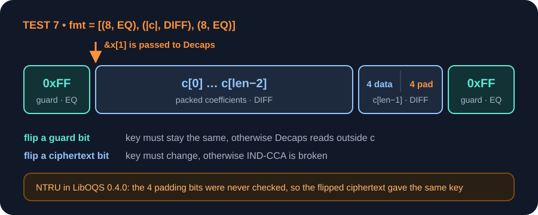
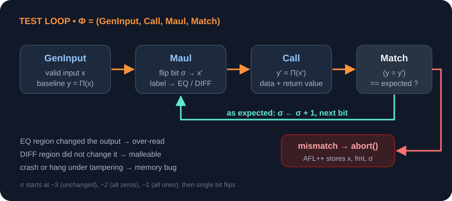
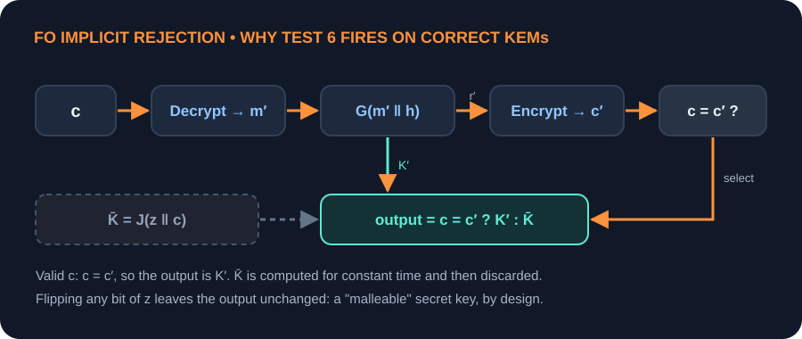

# 翻转一个比特：不知道正确答案，怎么测试密码代码

*面向编写或测试密码代码的读者 · 约 15 分钟阅读 · 2026 年 10 月 21 日*

最近读了 Fenzi、Gilcher 和 Virdia 发在 TCHES 2026 上的一篇论文（[论文](https://doi.org/10.46586/tches.v2026.i1.425-447)、[代码](https://github.com/jangilcher/cryptoTesting)），讲的是怎么测试密码算法的实现。读它的原因很简单：这段时间一直在看 NGCC 首轮的公开评审，里面有一类实现问题反复出现，而这篇论文给了一个专门找这类问题的办法。

先看论文里的一个例子。[LibOQS](https://github.com/open-quantum-safe/liboqs) 是 Open Quantum Safe 项目维护的后量子密码 C 库（[Stebila、Mosca](https://doi.org/10.1007/978-3-319-69453-5_2)），用得比较多，2020 年的 0.4.0 版本里收录了 NTRU 这个 KEM。NTRU 的密文长度不是整字节，最后一个字节有 4 位是填充，规范要求填 0，但解封装代码没有检查这 4 位。结果就是把其中任意一位改掉，密文照样能解封装，解出来的还是原来那个密钥。

对 KEM 来说这是个严重问题，第 3 节会解释原因。可它当时并没有被常规测试发现。程序不崩溃，KAT 也都能通过，因为 KAT 里的密文全是合法的。

下面先介绍论文的方法和它找到的 bug，最后结合 NGCC 评审里的问题，说说这个方法还漏掉了什么。

## 1. 密码代码为什么难测

写普通程序，测试一般就是拿输出和一个已知的正确答案比。密码代码麻烦的地方在于，这个正确答案往往拿不到。

最常见的做法是已知答案测试（KAT）：固定一组输入，把输出和事先存下来的结果对比。问题是这些结果是参考实现跑出来的，参考实现错了，KAT 也跟着错。另外 KAT 只覆盖合法输入，NTRU 这种只有密文被改过才会暴露的问题，KAT 碰不到。

AddressSanitizer 和 [AFL++](https://www.usenix.org/conference/woot20/presentation/fioraldi) 这类工具也帮不上忙。前者只管内存越界，后者主要看程序会不会崩溃。NTRU 那个 bug 既没有越界，也没有崩溃，只是给了一个错误的结果，而这个结果看上去和正常密钥没什么区别。

说到底，密码算法的输出本来就设计得像随机数。测试拿到 `3f a1 9c ...` 这样一串字节，没法判断它对不对。软件测试里把这叫做 oracle problem（[Weyuker, 1982](https://doi.org/10.1093/comjnl/25.4.465)），意思是缺一个能判断输出对错的“裁判”。

## 2. 换个思路：比较两个输出

单个输出对不对判断不了，但两个输出之间应该是什么关系，很多时候是清楚的。利用这种关系来测试，叫做变形测试（metamorphic testing，[Chen、Cheung、Yiu，1998](https://arxiv.org/abs/2002.12543)；[Chen、Tse、Zhou，2003](https://doi.org/10.1016/S0950-5849%2802%2900129-5)）。

拿哈希函数举例。`H(x)` 应该等于多少我们不知道，但有两点可以肯定：消息里任何一位改了，哈希值都得变；消息后面内存里的字节改了，哈希值不能变。前一条查的是有没有漏读输入，后一条查的是有没有读到不该读的地方。两条都不需要知道正确答案，改一位，重新算，比一下就行。

这个做法早就有人用过。2018 年，[Mouha 等人](https://doi.org/10.1109/TR.2018.2847247)用这两条规则检查了 SHA-3 竞赛的 86 个参考实现，19 个违反第一条，17 个违反第二条，其中有两个是决赛算法。

第二条规则要靠守卫字节来测：在输入前后各多放一个字节，传给被测函数的指针指向中间的真实输入。改了守卫字节、结果却变了，就说明函数读出了界。KEM 密文的情况如下图，橙色那块就是 NTRU 出问题的填充位。



守卫字节这个设计很实用，它能抓到 sanitizer 抓不到的情况。sanitizer 只在访问未分配的内存时报错，如果函数读的是同一块大缓冲区里紧挨着的下一个字节，sanitizer 不会管。

## 3. 从安全定义到测试规则

论文做的，是把这套思路从哈希搬到 KEM 和签名上。我觉得它最有意思的地方在于：KEM 和签名的安全定义，本身就可以直接拿来当测试规则。

KEM 的标准安全目标是 IND-CCA，大意是：攻击者可以要求系统解封装任意密文，只有他要攻击的那一个不行；即使这样，他也得不到那个密文里密钥的任何信息。

回到 NTRU。攻击者拿到目标密文，改掉一个填充位，就得到了一个“不同”的密文，可以正常提交给系统解封装，而系统返回的正是目标密钥。所以单这一个 bug，就足以打破 IND-CCA。

反过来看，IND-CCA 正好给出一条测试规则：合法密文改任何一位，解封装得到的密钥都必须变。

签名也一样。一般的要求是没人能给新消息伪造签名。强不可伪造（sUF-CMA）要求更高：对已经签过的消息，也不能再造出另一个不同的签名。有些协议拿签名当唯一标识，依赖的就是这一点。对应的规则是：合法签名改任何一位，或者改它的长度，验证都必须失败。不过 NIST 没有要求强不可伪造，方案如果没声明这个性质，违反它就算不上 bug。

## 4. 测试程序长什么样

每个测试的流程都差不多。先构造一个合法输入，比如一对密钥加一个密文，算出正常的输出；然后改掉输入的一位，再算一次；最后按规则检查输出该不该变，不对就故意让程序崩溃。改一位、重算、检查这三步，对输入的每一位都做一遍。

故意崩溃是为了借用 AFL++ 保存出问题的输入。论文里 AFL++ 自带的随机变异全部关掉了，只用它并行跑测试、存结果。



正式逐位翻转之前，还会先试三种特殊输入：原样不动、全 0 和全 1。论文把这个循环拆成 `GenInput`、`Maul`、`Call`、`Match` 四部分，只有 `Call` 和具体算法有关，其余部分所有方案共用。

论文一共写了 13 个测试，覆盖哈希、密钥生成、封装、解封装、签名、验证这些函数的每个输入。用到随机数的地方，随机数会被固定下来，保证结果能复现；另外还会换上一个永远只返回同一个字节的随机数生成器，看实现会不会因此死循环。签名长度可变的方案，长度字段也会被改。最关键的还是上一节说的两个：解封装前改密文（论文里的 Test 7），验证前改签名（Test 13）。

## 5. 测出了什么

作者测了 LibOQS 的四个版本（2018、2020、2023、2025 年），还有 SUPERCOP 里的哈希函数。SUPERCOP 是一个收录了大量实现的性能测试平台。测老版本是因为 LibOQS 会删掉在 NIST 竞赛中被淘汰的方案，只有老版本里还留着它们。一个版本完整跑下来，大约要在服务器上跑半天。

作为对照，作者在同样的代码上也跑了普通的 fuzzer：

| LibOQS 版本 | 普通 fuzzer | 新测试额外发现 |
| --- | --- | --- |
| 2018 | 27 次崩溃，1 次卡死 | 3 个 IND-CCA 失效 |
| 0.4.0（2020） | 17 次崩溃，1 次卡死 | 10 个 IND-CCA 失效、9 个 sUF-CMA 失效、3 个缓冲区溢出 |
| 0.8.0（2023） | 无 | 2 个 sUF-CMA 失效 |
| 0.14.0（2025） | 无 | 25 个 sUF-CMA 失效 |

最能说明问题的是后两行。在新版本上，普通 fuzzer 一个问题都没找到，新方法还是找出了几十处。反过来，普通 fuzzer 找到的崩溃，新方法基本都能找到，只漏了 Dilithium III 和 Picnic_L3_UR 的两个。

要说明的是，这些数字按方案、参数集和版本分开统计，并不等于独立 bug 的数量；而且第 7 节会讲到，其中一部分结果其实不是 bug。

## 6. 几个具体的 bug

看完论文里的这些 bug，我最大的感受是它们大多出在同一个地方：同一个值可以有好几种字节表示，而代码全都接受。

### NTRU

开头已经讲过，这里补充一下数字。受影响的三个参数集，密文由 11 位或 13 位的数拼接而成，比如 HPS-2048-509 是 508 × 11 = 5588 位，不是 8 的倍数，所以最后一个字节空出 4 位。[修复](https://github.com/jschanck/ntru/commit/6bb52396fed494001228ca579f4c1d91ef558171)只加了一行检查：

```c
/* Check that unused bits of last byte of ciphertext are zero */
fail |= c[NTRU_CIPHERTEXTBYTES-1] & (0xff << (8 - (7 & (NTRU_LOGQ*NTRU_PACK_DEG))));
```

很多 KEM 在解封装时会重新加密一遍，再和收到的密文逐字节比较，那样的话这几位一定会被发现。NTRU 没有重新加密，而是直接检查解码后的数，填充位在解码时就被扔掉了。我猜这就是它漏掉的原因。

较新的签名方案 SNOVA 也有一样的问题，出在部分参数集签名的最后一个字节。

### Falcon

Falcon 签名里的每个数，用一个符号位加上数值大小来编码。解码器接受了“负零”（符号位为 1、数值为 0）这种写法，也不检查末尾的填充是不是 0（[liboqs issue #1315](https://github.com/open-quantum-safe/liboqs/issues/1315)），于是同一个签名可以写成好几种样子。Falcon 基于 [GPV 框架](https://eprint.iacr.org/2007/432)，按理说是有强不可伪造性的，用户也自然会这么认为，所以这个问题比较可惜。Falcon 团队在规范 1.2 版里修掉了它。

### CROSS

CROSS 的签名是定长的，所以它的验证函数干脆没用传进来的签名长度。结果是在合法签名后面随便追加一些字节，验证照样通过（[issue](https://github.com/CROSS-signature/CROSS-lib-oqs/issues/1)）。这个问题只出现在按 PQClean API 写的版本里，提交给 NIST 的版本检查了长度。

### KNOT-384

这是一个哈希函数。消息长度正好是 6 字节的倍数时，优化版代码会多读一个字节，哈希值就随内存里紧挨着的内容变化。前面说的守卫字节在这里派上了用场。

还有一个发现容易被忽略。2018 年的版本里，有三个 KEM 收到被改过的密文会崩溃或者卡住。表面上这只是健壮性问题，但攻击者看得到崩溃，等于知道了“这个密文不合法”。已有的针对 KEM 的攻击，用的就是这种“是”或“否”的反馈，一次次查询，逐步把私钥试出来。

## 7. 不是所有结果都是 bug

有些结果来自方案本身的设计，算不上实现错误。论文管这些叫“特性”（features）。我觉得这部分写得不错，值得单独说一下。

最典型的是 KEM 私钥里那个平时用不上的部分。包括 ML-KEM 在内，大多数后量子 KEM 都用 [Fujisaki–Okamoto（FO）变换](https://doi.org/10.1007/3-540-48405-1_34)来达到 IND-CCA。常用的是“隐式拒绝”形式（[Hofheinz、Hövelmanns、Kiltz](https://eprint.iacr.org/2017/604)）：私钥里存一个随机值 `z`，遇到不合法的密文时不报错，而是返回一个用 `z` 算出来的假密钥。



对合法密文，这个假密钥也会照算一遍，这样两种情况耗时相同，算完再丢掉。所以改了 `z`，合法密文照样能解出正确的密钥。改私钥的测试（Test 6）几乎在所有 KEM 上都会报这个结果，但这不是 bug。只是如果某个系统靠“能正确解封装一个合法密文”来判断存储的私钥有没有损坏，那 `z` 坏了它是看不出来的。

随机化的 Dilithium 也有类似情况。私钥里有个值 `K` 只在确定性版本里用到，所以两个只差在 `K` 上的私钥，签出来的签名完全相同。标准化后的 ML-DSA 每次签名都会用到 `K`，这个问题就没有了。另一个例子是 2020 年的 LibOQS：部分 Rainbow 和 Falcon 的公钥可以被改掉，而原来的签名在新公钥下依然有效。这和排他所有权（exclusive ownership）有关（[Pornin、Stern](https://doi.org/10.1007/11496137_10)；[Cremers 等](https://eprint.iacr.org/2020/1525)），[Jackson 等](https://eprint.iacr.org/2019/779)的工作说明，协议缺少这个性质是会出问题的。

## 8. 单比特翻转漏掉了什么

这个方法的好处是简单，局限也在这里：每次只改一位，只从一个固定的输入出发，每个输出也只和原始输出比较。

我拿 [ngcc.dev](https://ngcc.dev/) 上已经公开的 NGCC 首轮问题对照了一遍。ngcc.dev 是 Markku-Juhani Saarinen 维护的公开评审网站。里面不少问题和论文要找的是同一类，论文的测试却抓不到。下面按情况整理了一下，每种情况都可以补一条规则，同样不需要知道正确答案。

### 改过的输出之间也要比较

Test 7 只检查改过的密文解出来的密钥和真实密钥不一样。但在 CheetahKEM 和 LoongKEM 里（[kem-09-1](https://ngcc.dev/reports/kem-09.html)、[kem-18-1](https://ngcc.dev/reports/kem-18.html)），用来选择密钥的掩码写错了，返回的是假密钥和真实密钥混在一起的结果，真实密钥的大部分位就这样泄露了。DKEM（[kem-13-1](https://ngcc.dev/reports/kem-13.html)，这个是我报告的）和 BAG-Loong（[kem-03-2](https://ngcc.dev/reports/kem-03.html)）的问题则是假密钥没有绑定整个密文，不同的非法密文会得到同一个假密钥。这几种情况下，返回的密钥都和真实密钥不同，Test 7 全都能通过。

补救办法是把所有改过的密文解出来的密钥收集起来，再查两件事：两两之间没有重复；没有哪个和真实密钥相同的位数明显超过一半。Mouha 等人最早其实就是把所有输出放在一起比较的，论文为了配合 AFL++ 的工作方式，改成了只和原始输出比较。

### 返回码也会泄露信息

DTRU（[kem-14-2](https://ngcc.dev/reports/kem-14.html)）在走拒绝分支时返回了不同的返回码，攻击者由此就能知道密文是否合法，而隐式拒绝本来就是要把这一点藏起来。论文虽然把返回码算进了输出，但改过的密文本来就应该得到不同的输出，所以测不出来。对隐式拒绝的 KEM，应该要求所有密文的返回码都一样。

### 要改数值，而不只是比特

很多格式按模 `q` 存数。如果解码器把 `x + q` 也当成 `x`，同一个值就又多了一种写法。翻转一位只会让数值变化 2 的幂，不可能刚好差一个 `q`，所以比特翻转发现不了。QIMEN-PIKE（[kem-31-2](https://ngcc.dev/reports/kem-31.html)）就是这样丢掉了 IND-CCA。最省事的检查是解码后再编码一次，看字节是否完全一致。

### 长度参数往两个方向试

论文只把签名长度往短了改。DTRU（[kem-14-1](https://ngcc.dev/reports/kem-14.html)）在密文长度传错时会栈溢出，Tins（[sign-29-3](https://ngcc.dev/reports/sign-29.html)）在签名长度过长时会缓冲区溢出。所以每个长度参数都应该在 AddressSanitizer 下往短、往长各试一次。

### 跨进程比较

HEP-QC（[kem-17-1](https://ngcc.dev/reports/kem-17.html)）没用 API 传给它的随机数生成器，而是用了自己的，每个进程都从同一个状态开始。同一个进程里连续生成的密钥各不相同，所以只在一个进程里测会通过；可每个新进程生成的都是同一对密钥，谁都能算出私钥。比较两个新进程生成的第一个密钥，就能发现这个问题。

### 不同实现之间对比

一个方案往往同时有参考实现和优化实现。FLIT 的两个版本算出的密钥不一样（[kem-15-1](https://ngcc.dev/reports/kem-15.html)），而且只有 AVX2 版本会接受大部分非法密文（[kem-15-2](https://ngcc.dev/reports/kem-15.html)）。把所有改过的输入分别交给每个版本，要求结果完全一致，就能在不知道正确答案的情况下发现这类问题。

### 有些改动要懂方案才想得到

TRINE（[sign-30-5](https://ngcc.dev/reports/sign-30.html)）里，把签名的某些部分乘以一个标量，得到的仍是合法签名。VDOO（[sign-33-7](https://ngcc.dev/reports/sign-33.html)）把消息和签名放在一起存，移动两者之间的分界，就得到了一条新消息的合法签名。随机翻比特几乎不可能碰到这类改动，但只要了解方案结构，每种都只需要几行测试代码。

### 哈希要比较不同长度的消息

Eijen（[hash-09-1](https://ngcc.dev/reports/hash-09.html)）里，空消息和 7 个 0 比特组成的消息哈希值相同。只有把不同长度的消息放在一起比较，才能看出来。

上面这些规则大部分不需要了解具体方案，可以像论文的测试一样，对竞赛里的所有候选自动跑一遍。

## 9. 自己动手试试

作者的代码放在 Docker 里。`bash run.sh` 启动容器后，运行 `bash reproduce.sh ches_liboqs`，就能复现他们在 LibOQS 0.14.0 上的结果。

如果只是想在自己的代码上跑最重要的那个测试，用不着这么复杂。下面这段对 liboqs 里任意一个 KEM 做 Test 7，带上了第 2 节说的守卫字节。为了简短，省略了错误处理。

```c
#include <oqs/oqs.h>
#include <stdio.h>
#include <stdlib.h>
#include <string.h>

static void flip(uint8_t *b, size_t bit) { b[bit / 8] ^= (uint8_t)(1u << (bit % 8)); }

/* 翻转合法密文的每一位，以及两侧守卫字节的每一位。 */
static int test_decaps_ct(const char *name) {
    OQS_KEM *kem = OQS_KEM_new(name);
    size_t clen = kem->length_ciphertext, sslen = kem->length_shared_secret;
    uint8_t *pk = malloc(kem->length_public_key), *sk = malloc(kem->length_secret_key);
    uint8_t *buf = malloc(clen + 2), *ss = malloc(sslen);
    uint8_t *ss0 = malloc(sslen), *ss1 = malloc(sslen);

    OQS_KEM_keypair(kem, pk, sk);
    buf[0] = buf[clen + 1] = 0xFF;                 /* 守卫字节 */
    OQS_KEM_encaps(kem, buf + 1, ss, pk);
    OQS_STATUS rv0 = OQS_KEM_decaps(kem, ss0, buf + 1, sk);

    int bad = 0;
    for (size_t bit = 0; bit < 8 * (clen + 2); bit++) {
        int in_ct = bit >= 8 && bit < 8 * (clen + 1);  /* 在密文内：密钥必须改变 */
        flip(buf, bit);
        OQS_STATUS rv1 = OQS_KEM_decaps(kem, ss1, buf + 1, sk);
        int same = rv0 == rv1 && memcmp(ss0, ss1, sslen) == 0;
        if (same == in_ct) {
            printf("%s: bit %zu: %s\n", name, bit, in_ct ? "same key" : "reads outside c");
            bad++;
        }
        flip(buf, bit);
    }
    OQS_KEM_free(kem);
    return bad;
}

int main(int argc, char **argv) {
    OQS_init();
    return argc == 2 ? test_decaps_ct(argv[1]) != 0 : 2;
}
```

签名的测试结构相同，循环里换成 `OQS_SIG_verify`，再加一个遍历所有错误长度的循环。第 8 节的第一条规则也容易加：把每次解出来的密钥存下来，最后两两比较。

最后说几点建议。凡是数据没把最后一个字节填满的地方，解码时都检查一下空出来的位是不是 0。每个值只接受一种编码，可以用“解码再编码、比较字节”来查。所有长度参数都要检查，往短往长都试一试。如果同时有参考实现和优化实现，就把 Test 7 和 Test 13 放进 CI，在每个版本上都跑，并要求结果完全一致。

我之前写的[关于 PQC 实现工程的文章](../pqc-implementation-guide/?lang=zh)里有一份更完整的自查清单，这里的测试能覆盖其中好几项。

## 来源

- Fenzi, Gilcher, Virdia，“Finding Bugs and Features Using Cryptographically-Informed Functional Testing”，[TCHES 2026(1), pp. 425–447](https://doi.org/10.46586/tches.v2026.i1.425-447)；[ePrint 2024/1122](https://eprint.iacr.org/2024/1122)；[代码](https://github.com/jangilcher/cryptoTesting)。论文 Table 3 列出了每个测试、每个版本的完整结果。
- Stebila, Mosca，“Post-quantum Key Exchange for the Internet and the Open Quantum Safe Project”，[SAC 2016](https://doi.org/10.1007/978-3-319-69453-5_2)；[liboqs 代码仓库](https://github.com/open-quantum-safe/liboqs)
- Mouha, Raunak, Kuhn, Kacker，“Finding Bugs in Cryptographic Hash Function Implementations”，[IEEE Transactions on Reliability 67(3), 2018](https://doi.org/10.1109/TR.2018.2847247)
- Weyuker，“On Testing Non-Testable Programs”，[The Computer Journal 25(4), 1982](https://doi.org/10.1093/comjnl/25.4.465)
- Chen, Cheung, Yiu，“Metamorphic Testing: A New Approach for Generating Next Test Cases”，[arXiv:2002.12543](https://arxiv.org/abs/2002.12543)（1998 年技术报告）
- Chen, Tse, Zhou，“Fault-Based Testing Without the Need of Oracles”，[Information and Software Technology 45(1), 2003](https://doi.org/10.1016/S0950-5849%2802%2900129-5)
- Fioraldi, Maier, Eißfeldt, Heuse，“AFL++: Combining Incremental Steps of Fuzzing Research”，[USENIX WOOT 2020](https://www.usenix.org/conference/woot20/presentation/fioraldi)
- Gentry, Peikert, Vaikuntanathan，“Trapdoors for Hard Lattices and New Cryptographic Constructions”，STOC 2008，[ePrint 2007/432](https://eprint.iacr.org/2007/432)
- Fujisaki, Okamoto，“Secure Integration of Asymmetric and Symmetric Encryption Schemes”，[CRYPTO 1999](https://doi.org/10.1007/3-540-48405-1_34)
- Hofheinz, Hövelmanns, Kiltz，“A Modular Analysis of the Fujisaki-Okamoto Transformation”，TCC 2017，[ePrint 2017/604](https://eprint.iacr.org/2017/604)
- Pornin, Stern，“Digital Signatures Do Not Guarantee Exclusive Ownership”，[ACNS 2005](https://doi.org/10.1007/11496137_10)
- Cremers, Düzlü, Fiedler, Fischlin, Janson，“BUFFing Signature Schemes Beyond Unforgeability and the Case of Post-Quantum Signatures”，IEEE S&P 2021，[ePrint 2020/1525](https://eprint.iacr.org/2020/1525)
- Jackson, Cremers, Cohn-Gordon, Sasse，“Seems Legit: Automated Analysis of Subtle Attacks on Protocols that Use Signatures”，ACM CCS 2019，[ePrint 2019/779](https://eprint.iacr.org/2019/779)
- [NTRU 修复：“Ensure trailing bits of ciphertext are 0”](https://github.com/jschanck/ntru/commit/6bb52396fed494001228ca579f4c1d91ef558171)
- [liboqs issue #1315：Malleable Falcon signatures](https://github.com/open-quantum-safe/liboqs/issues/1315)
- [CROSS-lib-oqs issue #1：Potential SUF-CMA violation](https://github.com/CROSS-signature/CROSS-lib-oqs/issues/1)
- [ngcc.dev](https://ngcc.dev/)，NGCC 首轮候选的公开评审（第 8 节引用的发现于 2026-10-21 访问）
