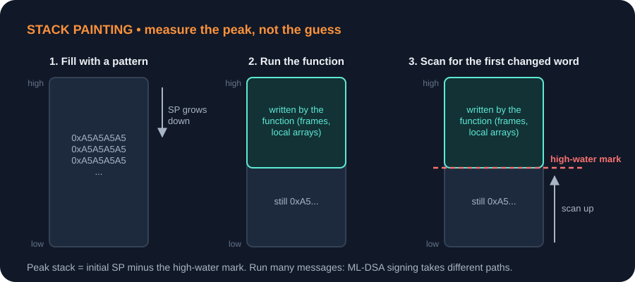
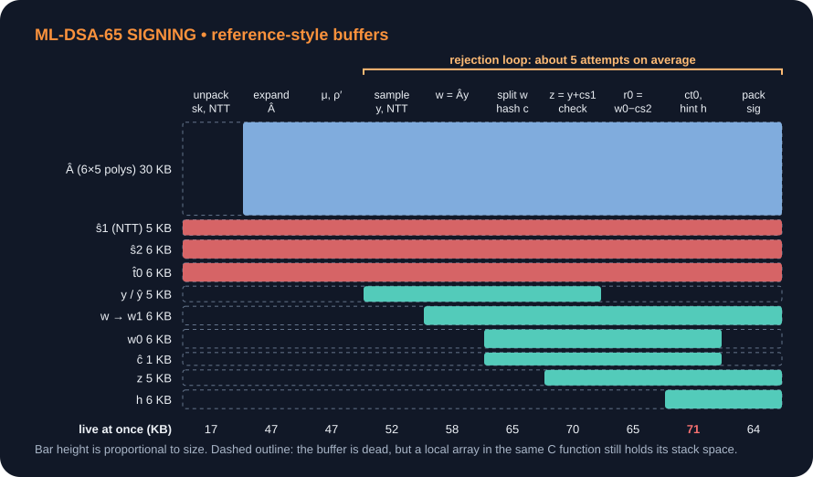
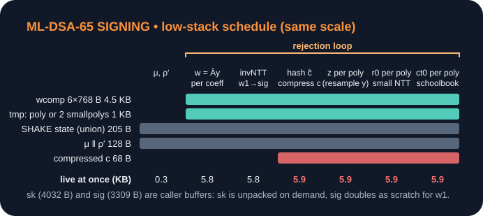
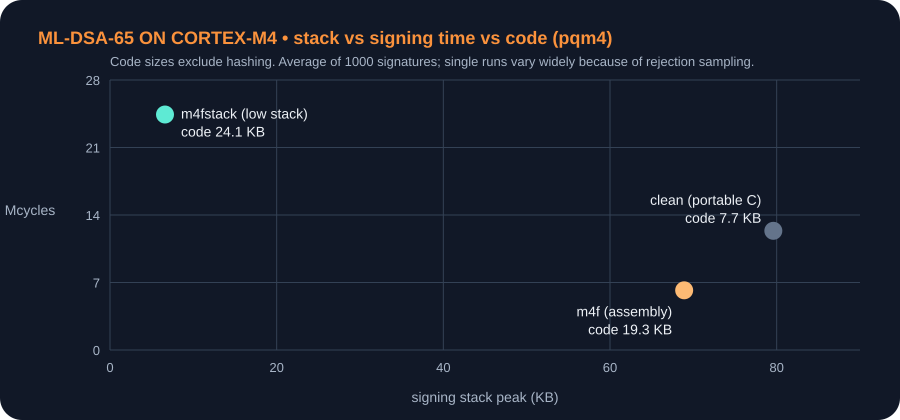
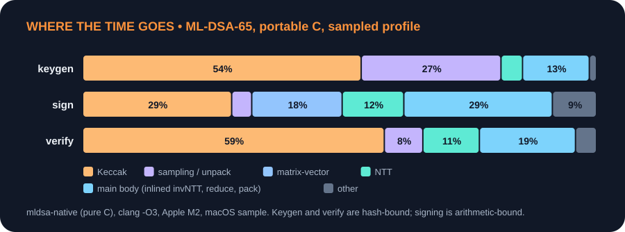
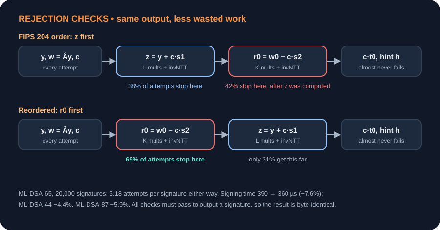
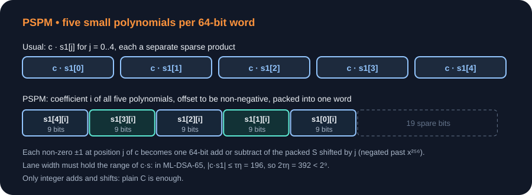

# 在小芯片上跑 ML-DSA：省内存、省代码、提速度，纯 C 能做到哪一步

*面向在 MCU 或嵌入式平台上实现后量子签名的读者 · 约 25 分钟阅读 · 2026 年 10 月 30 日*

ML-DSA（FIPS 204）的参考实现，签名一次要用大约 80 KB 栈。这对服务器不算什么，但很多 MCU 一共只有 64 KB 或 128 KB SRAM。另一方面，很多产品要求不能用汇编，只能用可移植的 C，以便过认证、换平台。

这篇文章把论文和开源代码里已知的做法整理成一份清单，分三部分：省 RAM、省代码尺寸、提速度。这三件事经常互相冲突，所以每一条都会标出它要付的代价。文中有一部分数字是我在 Apple M2 上用 [mldsa-native](https://github.com/pq-code-package/mldsa-native) 的纯 C 后端测的，主要用来比较相对变化；Cortex-M4 上的数字来自 [pqm4](https://github.com/mupq/pqm4)。

## 1. 先分清楚要优化的是哪一项

| | RAM（栈 / 堆） | 代码尺寸（flash） | 速度 |
| --- | --- | --- | --- |
| 关心的问题 | 运行到最深处时，同时存活的数据有多少 | 链接进固件的函数和常量一共多大 | 每次操作要多少周期 |
| 特点 | 看**峰值**，只和最深的那条调用路径有关 | 看**总和**，每个链接进来的函数都算 | 签名耗时随拒绝采样次数波动 |
| 怎么测 | 栈涂色、`-fstack-usage` | `arm-none-eabi-size`、`nm --size-sort` | DWT 周期计数器，多条消息取平均和最大值 |

三者经常冲突：

- 省 RAM 的手段多半要多写代码，或者把同样的东西重复计算。
- 为提速做的循环展开、查表会让代码变大。
- 只有“少编译一些东西进去”这类改动能同时省两边，比如只保留一个参数集、去掉不用的 API。

### 1.1 栈涂色法

MCU 上没有虚拟内存，栈溢出不会报错，只会悄悄改坏别的变量，所以栈的峰值必须实测。最常用的办法是栈涂色（stack painting）：先把整段栈填满一个特殊值，运行被测函数，再从栈的最远端往回扫，第一个被改过的字就是函数用到的最深位置。



裸机上的写法很短：

```c
extern uint32_t _sstack[], _estack[];   /* 链接脚本导出的栈边界 */
#define PAINT 0xA5A5A5A5u

void paint_stack(void) {
    uint32_t *p = _sstack, *sp;
    __asm volatile ("mov %0, sp" : "=r"(sp));
    while (p < sp - 16) *p++ = PAINT;        /* 只涂当前 SP 以下 */
}

size_t stack_high_water(void) {
    uint32_t *p = _sstack;
    while (p < _estack && *p == PAINT) p++;
    return (size_t)((uint8_t *)_estack - (uint8_t *)p);
}
```

使用时有几点要注意：

- 中断如果和函数共用同一个栈，测量期间触发的中断会把水位推高。
- 被测函数如果恰好写入了涂色值，结果会偏小几个字。
- ML-DSA 签名的拒绝采样每次走的分支不一样，要用多条消息测，取最大值。

没有开发板时，可以在 PC 上开一个固定大小栈的线程做同样的事，量级是可信的。GCC 的 `-Wstack-usage=N` 可以在 CI 里拦住单个栈帧过大的函数，和涂色法互补。

## 2. ML-DSA 签名的内存花在哪里

以 ML-DSA-65 为例，矩阵维度 K = 6、L = 5。一个多项式有 256 个系数，按 `int32_t` 存放，占 1 KB。

| 对象 | 大小 | 说明 |
| --- | --- | --- |
| Â，NTT 域的公开矩阵 | 30 KB | 由 32 字节的种子 ρ 用 SHAKE128 展开 |
| ŝ1、ŝ2、t̂0 | 17 KB | 秘密向量，从 sk 解包后转到 NTT 域 |
| y、w、w0、z、h | 共约 28 KB | 拒绝采样每一轮都会重新计算 |
| sk、sig | 4032 B、3309 B | 调用方提供的缓冲区 |

把它们按签名的阶段画出来，就是下面的生命周期图。图中每条带子的高度和缓冲区大小成正比；某一列所有实心块的高度之和，就是那一刻同时存活的内存。



图里虚线框的部分说明了一个 C 语言特有的问题：同一个函数里的局部数组，从进入函数到返回一直占着栈，不管后面还用不用。所以“缩短生命周期”在 C 里要落实到具体写法上：要么用 `union` 让先后用到的数组共用一块空间，要么把代码拆成几个子函数，让它们的栈帧先后出现。

从图上还能直接看出三个方向：

- Â 最大，但它完全由 32 字节的 ρ 决定，可以随用随生成。
- 秘密向量在 sk 里本来就有一份紧凑编码，s1、s2 每个系数只占 3～4 bit，可以用到时再解包。
- 每一轮的临时量彼此寿命错开，可以复用同一块空间，有的甚至不必整块保存。

## 3. 省 RAM 的手段

这一节的手段主要来自三处：[Greconici 等人的 TCHES 2021 论文](https://eprint.iacr.org/2020/1278)、[Bos、Renes、Sprenkels 的 AFRICACRYPT 2022 论文](https://eprint.iacr.org/2022/323)（pqm4 的 `m4fstack` 就是这条路线），以及 mldsa-native 的 `MLD_CONFIG_REDUCE_RAM` 选项。

| 手段 | 省多少（ML-DSA-65） | 代价 |
| --- | --- | --- |
| **Â 按需生成**：每次只生成一个多项式，乘完就扔；更彻底的做法是 SHAKE 每输出一个系数就立刻乘加进 w，连一个多项式都不存 | 30 KB | 拒绝采样每转一圈都要重新展开 Â，SHAKE128 调用量随之翻约 5 倍 |
| **w 用 24 bit 存**：系数都小于 q < 2²³，3 个字节就够 | 6 KB → 4.5 KB | 每次读写多一次打包和解包 |
| **y 不存**：算 w 时生成一次，算 z = y + c·s1 时用同样的种子再生成一次 | 5 KB | 每轮多做 L 次 SHAKE256 展开 |
| **s1、s2、t0 按需解包**：c·s1、c·s2 改用模 769 的 16 位小 NTT；c·t0 用 schoolbook 乘法直接读打包的 t0 | 17 KB | 多出一套小 NTT 和 schoolbook 代码 |
| **c 压缩**：只存非零位置和符号 | 1 KB → 68 B | 每次使用前解压 |
| **复用空间**：SHAKE128、SHAKE256 的状态放进同一个 union；sig 缓冲区先暂存打包好的 w1，再被正式内容覆盖 | 几百 B 到几 KB | 几乎没有 |

用小模数算 c·s1 不会出错，是因为结果本身很小：c 只有 τ 个 ±1，s1 的系数绝对值不超过 η，所以乘积的系数绝对值不超过 τ·η。ML-DSA-65 中这个值是 49 × 4 = 196，小于 769/2，在模 769 下算出的结果和在模 q 下完全一样。

把这些手段都用上以后，在同样的比例尺下，生命周期图只剩一条细带：



验签也能用同样的思路降内存：一行一行地算 w′1，每行算完立刻吸收进 SHAKE。Gonzalez 等人在 [PQCrypto 2021](https://eprint.iacr.org/2021/662) 上更进一步，把公钥和签名本身也按块流式读入，目标设备只有 8 KB RAM。

验签有两种折中：

- **Linux 内核的只验签实现**（[`lib/crypto/mldsa.c`](https://git.kernel.org/pub/scm/linux/kernel/git/torvalds/linux.git/tree/lib/crypto/mldsa.c)）：Â 每次只生成一个元素，但 ẑ 只做一次 NTT，之后一直保存，工作区约 10 KB。
- **pqm4 的 `m4fstack`**：为了把栈压到 2.7 KB，每一行都对 z 重新做 NTT，验签因此慢了约 2.4 倍。

还有一种情况：如果签名密钥固定不变，比如设备的身份密钥，那么 Â 也是固定的，可以事先算好放进 flash，签名时直接读，不用重新生成。这样能在保持低 RAM 的同时拿回大部分速度，但 Â 要占 16 KB、30 KB 或 56 KB（分别对应 ML-DSA-44、65、87）的 flash。

省内存的代价几乎全落在签名上：



| ML-DSA-65 on Cortex-M4（pqm4） | 密钥生成 | 签名 | 验签 | 代码（不含哈希） |
| --- | --- | --- | --- | --- |
| clean（可移植 C） | 60.8 KB · 3.21 M | 79.6 KB · 12.36 M | 57.7 KB · 3.38 M | 7.7 KB |
| m4f（汇编） | 60.8 KB · 2.52 M | 68.9 KB · 6.19 M | 9.9 KB · 2.42 M | 19.3 KB |
| m4fstack（低栈） | 4.4 KB · 3.41 M | 6.6 KB · 24.42 M | 2.7 KB · 5.73 M | 24.1 KB |

表中每格是“栈峰值 · 平均周期数”，M 表示百万周期。

几个规律：

- **省栈的代价集中在签名上。**密钥生成只慢 35%，签名却慢了将近 4 倍，因为只有签名有拒绝采样循环，每一圈都要重新生成 Â 和 y。
- **栈从 70 KB 降到 15 KB 比较便宜，再往下就贵了。**前一段主要靠“Â 按需生成 + 借用 sk + union”就能做到，mldsa-native 的 `REDUCE_RAM` 就停在这一档。后一段才需要小 NTT、schoolbook、逐系数采样和重新采样 y。

## 4. 代码尺寸：省栈之后为什么反而变大

RAM 看的是峰值，代码尺寸看的是总和，所以两者的优化方向不一样。上一节的低栈手段几乎每一条都会增加代码：小模数 NTT 是另一套 NTT，schoolbook 是另一种乘法，压缩的 w 和 c 需要额外的打包、解包函数。pqm4 里，`m4fstack` 比汇编版 `m4f` 多了约 5 KB 代码。

纯 C 下控制代码尺寸的常用做法：

- **只编译一个参数集，只保留用到的 API。**只验签的设备可以去掉签名和密钥生成。mldsa-native 有 `MLD_CONFIG_PARAMETER_SET`、`MLD_CONFIG_CORE_API_ONLY`、`MLD_CONFIG_NO_SIGN_API` 等选项；wolfSSL 有 `WOLFSSL_MLDSA_VERIFY_ONLY`。
- **全系统只放一份 Keccak。**ML-KEM、ML-DSA、SLH-DSA 都依赖 SHAKE，应该共用同一个实现。纯 C 下不需要 4 路并行 Keccak（mldsa-native 的 `MLD_CONFIG_SERIAL_FIPS202_ONLY`），能同时省代码和 RAM。
- **Keccak-f 的写法本身就是一个大开关。**24 轮全部展开会比循环写法大好几 KB，但更快。
- **编译选项。**`-Os`、`-ffunction-sections -fdata-sections -Wl,--gc-sections`、LTO 是基本配置。`-O2` 编出来的代码可能是 `-Os` 的 2～4 倍。可以只给 Keccak、NTT 这几个热点文件用 `-O2`，其余用 `-Os`。
- **测量要链接后再测。**只看 `.o` 会把最后会被去掉的代码也算进去。另外 x86 上的数字不能直接拿来推算：32 位 Arm 上哈希部分会更大，格运算部分会更小。

## 5. 时间花在哪里

讨论提速之前，先看纯 C 实现的时间分布：



这和已有的测量一致：

- [Zheng 等人](https://arxiv.org/abs/2306.01989)用 `perf` 剖析过 Dilithium3 的参考 C 实现：签名中 Keccak 置换占 38.8%，`montgomery_reduce` 一个函数就占 23.0%。
- pqm4 在 Cortex-M4 上测得，纯 C 版本签名的哈希占比是 31%。格运算改用汇编以后，哈希占比升到 61%。

所以提速要分两头：

- 签名要减少拒绝采样循环里的算术运算。
- 密钥生成和验签主要靠更快的 Keccak。

## 6. 提速一：调整拒绝检查的顺序

FIPS 204 签名的每一轮依次检查三项：z 是否太大、r0 是否太大、c·t0 和提示 h 是否合格。任何一项不通过，这一轮就作废。参考实现按这个顺序写：先把 z 的 L 个多项式都算出来，再算 r0。

问题在于 r0 检查更容易失败。按 [Zheng 等人](https://arxiv.org/abs/2306.01989)给出的概率，ML-DSA-65 中 z 通过的概率是 0.62，r0 只有 0.32。由于三项检查都要通过才能输出签名，调换检查顺序不会改变最终的签名，只会改变被拒绝的那一轮在哪一步停下。



我在 mldsa-native 上试了一下：它本来就会在每算完一个 z 多项式后立即检查、失败就退出；我在此基础上把 r0 的计算和检查整体挪到 z 前面，其他代码不动。统计 20000 个签名：每个签名平均尝试的轮数不变（ML-DSA-44、65、87 分别为 4.36、5.18、3.94 轮），签名耗时分别下降 4.4%、7.6%、5.9%，签名输出逐字节相同。c·t0 检查在这 20000 个签名里一次都没有拒绝过。

这个思路 mldsa-native 的维护者也已列入计划（[issue #1431](https://github.com/pq-code-package/mldsa-native/issues/1431)）。Zheng 等人在 Round 3 参考实现上测到的收益是 2.1%～3.0%。

还有一些更激进的做法也能减少浪费，但它们会改变签名算法的输出，用标准验签仍能通过，但和 FIPS 204 规定的签名流程不再一致，需要 FIPS 合规或要过 KAT 测试时不能用：

- **复用 y 的尾部**（[Sprenkels、Westerbaan](https://eprint.iacr.org/2020/1158)）：r0 检查失败时只重新采样 y 的一部分，签名快 11%～22%。
- **预拒绝采样**（[Yan 等人](https://doi.org/10.1186/s42400-024-00325-6)）：在密钥生成阶段筛选密钥，第四项检查的失败率下降 17%～47%，但签名只快约 1%。原因是提示检查本来几乎不会失败：在我的统计里，它平均每个签名拒绝不到 0.01 次。
- **wolfSSL 的 `WOLFSSL_MLDSA_SIGN_CHECK_Y` 和 `CHECK_W0` 选项**：在 y、w0 阶段就用更严的范围提前判断，会误拒 1%～5% 原本合格的轮次。

[Ravi 等人](https://eprint.iacr.org/2019/420)较早系统地研究过提前判断拒绝条件，以及哪些中间结果可以预先计算，在 Intel 和 Cortex-M4 上的提速为 6%～35%。

## 7. 提速二：缓存展开后的密钥

每次签名，参考实现都要从 sk 重新做两件只和密钥有关的事：

- 用 SHAKE128 展开 Â；
- 把 s1、s2、t0 解包并做 NTT。

如果同一把密钥要签很多次，这些结果完全可以缓存。我在 mldsa-native 上加了一个只用于测试的缓存：第一次签名时把 Â、ŝ1、ŝ2、t̂0 存下来，之后直接复用。

| 签名耗时（µs，Apple M2） | 默认 | 缓存展开密钥 | 缓存 + 先查 r0 |
| --- | --- | --- | --- |
| ML-DSA-44 | 248 | 201（−19%） | 191（−23%） |
| ML-DSA-65 | 390 | 309（−21%） | 280（−28%） |
| ML-DSA-87 | 477 | 340（−29%） | 311（−35%） |

缓存的代价是内存：ML-DSA-65 需要 30 KB（Â）加 17 KB（ŝ1、ŝ2、t̂0），共 47 KB；ML-DSA-87 约 79 KB。这正是第 3 节想省掉的那部分，所以它和低内存目标直接冲突。另外 ŝ1、ŝ2、t̂0 是秘密数据，缓存的生命周期要和 sk 一样受到保护，用完要清零。

几个主流库在这一点上的选择不一样：

- **BoringSSL** 在 2026 年 6 月的[一次提交](https://boringssl.googlesource.com/boringssl/+/ff43c4eb7f048a99c099201f3f058f0d0655a6fc)中，改为在密钥生成时就把 s1、s2、t0 存成 NTT 形式：签名快 3.8%～8.5%，密钥生成慢 11%～16%。提交说明的理由是：密钥生成本来就要对 s1 做 NTT，所以即使一把密钥只签一次，总计算量也更少。
- **Go 标准库的 [`crypto/mldsa`](https://github.com/golang/go/blob/master/src/crypto/internal/fips140/mldsa/mldsa.go)**：私钥对象里把 Â、ŝ1、ŝ2、t̂0、t̂1 全部展开保存；公钥则刻意不缓存。源码注释的解释是：缓存后公钥会超过 68 KB；公钥往往只用来验一次签名，却可能长时间留在内存里，比如作为 TLS 连接的对端证书。
- **RustCrypto 的 [`ml-dsa`](https://github.com/RustCrypto/signatures/tree/master/ml-dsa)**：私钥和公钥都做预计算，公钥里缓存 Â 和 2ᵈ·t̂1。
- **wolfSSL**：用编译选项让使用者自己选择，`WC_MLDSA_CACHE_MATRIX_A`、`WC_MLDSA_CACHE_PRIV_VECTORS`、`WC_MLDSA_CACHE_PUB_VECTORS` 分别缓存 Â、私钥向量、公钥向量。
- **OpenSSL 3.5 及以后的版本**：每次签名都重新展开 Â、对 s1、s2、t0 做 NTT，而且要把 z 和 r0 都算完才一起检查。在同一台 M2 上，它的 ML-DSA-65 签名耗时约 552 µs，mldsa-native 约 399 µs；密钥生成和验签两者相近。

## 8. 提速三：算术层的 C 写法

### 8.1 让小函数能被内联

Montgomery 约减只有几条指令，但 NTT 和逐点乘每处理一个系数都要调用一次。参考实现把它放在单独的 `reduce.c` 里，如果不开 LTO，编译器就没法跨文件内联。这就是它在剖析结果里单独占 23% 的原因。

我用 `-fno-inline` 编译 mldsa-native 来模拟这种情况：签名从 399 µs 变成 750 µs，慢了 1.88 倍，`montgomery_reduce` 一个函数就占了 34% 的采样。解决办法是把这类函数写成头文件里的 `static inline`、开启 LTO，或者像 mldsa-native 那样把所有源文件拼成一个编译单元。

### 8.2 Montgomery、Barrett，还是预计算商的乘法

模 q 乘法有三种常见写法：

| 写法 | 谁在用 | 做法 | 输出 |
| --- | --- | --- | --- |
| 有符号 Montgomery | 参考实现、mldsa-native、Linux 内核 | t = a·q⁻¹ mod 2³²，(a − t·q) >> 32 | a·2⁻³² mod q，范围 (−q, q)，可以延迟约减 |
| 泛型 Barrett | RustCrypto（`module-lattice`） | 商 ≈ (x·⌊2⁴⁶/q⌋) >> 46，余数 = x − 商·q，再条件减一次 | [0, q)，完全约减 |
| 预计算商的乘法（Shoup / Barrett 乘法） | [Neon NTT](https://eprint.iacr.org/2021/986)、mldsa-native 计划中的 twisted zetas | 乘数 w 固定，预先存 w′ = ⌊w·2³²/q⌋，r = a·w − q·((a·w′) >> 32) | [0, 2q) |

RustCrypto 的 Barrett 写法简单、通用，同一个宏同时用于 ML-KEM 和 ML-DSA，输出始终完全约减，不需要跟踪中间值的范围。代价是 x·⌊2⁴⁶/q⌋ 有 70 位，必须用 128 位乘法。我写了一个微基准，三种写法都先对 200 万对随机数核对过结果，然后测速：

- **Apple M2，关闭自动向量化**：每次乘法 Barrett 1.65 ns、Montgomery 1.05 ns、预计算商 1.12 ns。开启向量化后，预计算商的写法降到 0.19 ns，另外两种几乎没有变化。
- **Cortex-M4**：看编译出的指令。Montgomery 的核心是 `smull`、`muls`、`smlal` 三条指令；Barrett 要用 `umull`、`umull`、`umlal` 拼出 70 位乘积，再加移位、拼接、`mla` 和一次条件减法，大约 9～10 条指令。M4 的乘法和乘加都是单周期，所以按指令数估计，Montgomery 每次约减大约快 2.5 倍。这个数字是估算，不是上板实测。

对 NTT 来说，乘数是旋转因子，事先就知道，所以预计算商的写法最合适。代价是每个旋转因子要多存一个 w′。mldsa-native 正在计划把它和“两层 NTT 合并”一起用到 C 版本里（[issue #1118](https://github.com/pq-code-package/mldsa-native/issues/1118)）。

### 8.3 延迟约减

NTT 每做完一层蝴蝶运算，不必马上约减到 [0, q)，只要保证中间值不超出 32 位范围就行。mldsa-native 的 C 版 NTT 就是这样写的：每个蝴蝶块的注释和 CBMC 合约里都写明了“这一层之后系数的界增加 q”，并用形式化工具证明整个 NTT 不会溢出。

Go 的实现选择了另一种做法：每一步都完全约减到 [0, q)，代码更简单，代价是多几条约减指令。自己改写时最大的风险就是把界算错导致溢出，所以要么照搬已经证明过的界，要么加上断言测试。

### 8.4 小改动

- **Decompose 用一次高位乘法代替两步除法**（[issue #1177](https://github.com/pq-code-package/mldsa-native/issues/1177)）。ML-DSA-65 和 87 可以写成 `(a·1074791425 + 2⁴⁸) >> 49`。
- **乘法器慢的 CPU**，比如 Cortex-M0 的 32 周期乘法器：wolfSSL 提供了 `MLDSA_MUL_Q_SLOW`、`MLDSA_MUL_QINV_SLOW` 等选项，把乘以 q、q⁻¹ 改成移位和加减。
- **[Huang 等人](https://tches.iacr.org/index.php/TCHES/article/view/11419)** 在 Cortex-M3/M4 的 16 位 NTT 里用 Plantard 约减代替 Montgomery。这是汇编实现，在 C 里能否同样获益，要看编译器能不能生成相应的指令。

## 9. 提速四：用打包的小系数乘法代替 NTT

c·s1、c·s2、c·t0 都是“稀疏多项式乘小系数多项式”：c 只有 τ 个 ±1（ML-DSA-65 中 τ = 49），s1、s2 的系数在 [−η, η] 之间。参考实现仍然用 NTT 来算，每个多项式都要做一次完整的 invNTT。

[Zheng 等人在 ACSAC 2022 提出的 PSPM](https://doi.org/10.1145/3564625.3564629)（并行小多项式乘法）换了一种思路：把多个多项式同一位置的系数拼进一个 64 位字，c 的每个非零位置只需要对整个字做一次加或减。



这本质上是在一个寄存器里做 SIMD，只用到整数加减和移位，纯 C 就能写。论文在 Round 3 参考 C 实现上测到，Dilithium2、3、5 的签名分别快 18%、30%、27%，验签分别快 19%、7%、3%。后续的[改进版本](https://arxiv.org/abs/2306.01989)结合了提前判断，签名又快 5%～6%。

Cortex-M4 上常用的另一条路是小模数 NTT（[Abdulrahman 等人，ACNS 2022](https://eprint.iacr.org/2022/112)）：在模 769 上用 16 位系数做 NTT，配合 M4 的 16 位 SIMD 指令，签名中 basemul 加 invNTT 这部分快了 33%～38%。但这依赖汇编。在纯 C 的约束下，PSPM 更合适。

## 10. 提速五：Keccak

密钥生成和验签有一半以上的时间在 Keccak 里，这部分只能靠 Keccak 本身的实现来提速。纯 C 可选的实现有：

| 实现 | 适合的平台 | 说明 |
| --- | --- | --- |
| [XKCP](https://github.com/XKCP/XKCP/tree/master/lib/low/KeccakP-1600) `plain-64bits/KeccakP-1600-opt64.c` | 64 位 CPU | 可以完全展开，并使用 lane complementing；速度快，代码大 |
| XKCP `plain-32bits-inplace/KeccakP-1600-inplace32BI.c` | 32 位 MCU | bit interleaving：把每个 64 位 lane 拆成奇数位、偶数位两个 32 位字，64 位循环移位变成两次 32 位移位 |
| XKCP `compact/KeccakP-1600-compact64.c` | 代码尺寸优先 | 用循环写，最小也最慢 |

还有两点值得注意：

- **在 32 位平台上，要按整个 lane 吸收数据。**[mldsa-native issue #450](https://github.com/pq-code-package/mldsa-native/issues/450) 指出，在 Armv7-M 上使用 bit-interleaved 的 Keccak 时，每异或进一个 lane 要多 37 条指令；如果数据没有对齐到整个 lane，这个开销要付两次。拼接哈希输入时应该先缓冲，凑够整个 lane 再吸收。
- **汇编带来的收益也有限。**[Huang 等人](https://tches.iacr.org/index.php/TCHES/article/view/11419)在 Cortex-M4 上用汇编把 Keccak 提速约 21%，但哈希在 Dilithium 总时间中的占比只下降了 2.46%～5.03%。

## 11. 编译器和编译选项

同一份 mldsa-native 代码，换编译器和优化选项，ML-DSA-65 签名耗时可以差一倍以上（Apple M2，单位 µs）：

| 配置 | 密钥生成 | 签名 | 验签 |
| --- | --- | --- | --- |
| clang -Os | 179.8 | 511.7 | 158.8 |
| clang -O2 | 131.0 | 413.3 | 114.3 |
| clang -O3 | 127.6 | 398.8 | 109.2 |
| gcc-14 -Os | 207.1 | 545.4 | 182.1 |
| gcc-14 -O2 | 167.5 | 439.4 | 145.4 |
| gcc-14 -O3 | 158.4 | 365.5 | 133.9 |
| clang -O3，关闭自动向量化 | 136.0 | 432.9 | 115.8 |
| clang -O3 -fno-inline | 158.5 | 749.7 | 169.4 |

从这张表里能看出：

- **没有哪个编译器在所有操作上都最快。**gcc -O3 签名最快，但密钥生成和验签比 clang 慢约 23%。两个编译器都要在目标平台上实测。
- **`-Os` 比 `-O3` 慢 28%～49%。**
- **自动向量化在 M2 上值 8% 左右。**Cortex-M4 没有 128 位 SIMD，这部分收益在 M4 上不存在。
- 在 Cortex-M 上一定要写对 `-mcpu=cortex-m4`，否则编译器可能不会使用 DSP 指令和硬件除法。

## 12. 怎么组合

| 手段 | RAM | 代码 | 签名速度 | 输出与 FIPS 204 一致 |
| --- | --- | --- | --- | --- |
| 只编一个参数集、精简 API | 省 | 省 | 不变 | 是 |
| 串行 Keccak，全系统共用一份 | 省 | 省 | 基本不变 | 是 |
| 小函数内联 / LTO | 不变 | 略增 | 不内联会慢 1.9 倍 | 是 |
| 先查 r0 | 不变 | 几乎不变 | 快 4%～8% | 是 |
| Â 按需生成、借用 sk、union | 70 KB → 约 15 KB | 不变或略降 | 签名慢约 1.9 倍（纯 C） | 是 |
| 压缩 w 和 c、y 重新采样、小 NTT、schoolbook | 约 15 KB → 约 6 KB | 多约 5 KB | pqm4 上比汇编版慢约 4 倍 | 是 |
| 缓存展开密钥（RAM 或 flash） | 多 47 KB（ML-DSA-65） | 不变 | 快 19%～29% | 是 |
| PSPM | 不变 | 多一套乘法 | 快 18%～30%（Round 3 参考 C） | 是 |
| 复用 y 的尾部、提前范围检查 | — | — | 快 11%～22% | 否 |

如果一个设备 RAM 很紧、代码预算也有限，可以按这个顺序做：

1. **先做不花代价的。**确认约减函数会被内联；只编一个参数集；用串行 Keccak；把 r0 检查挪到 z 前面。这几项都不增加 RAM，也不改变输出。
2. **再按 RAM 预算选档位。**十几 KB 栈够用的话，停在“Â 按需生成”这一档（比如 mldsa-native 的 `REDUCE_RAM`），代码不会变大。只有 RAM 实在不够，才考虑往下压到 6 KB。
3. **如果密钥固定，再考虑缓存。**把 Â 放进 flash，用 flash 换回速度；前提是 flash 预算允许。
4. **最后才做代码量大的优化。**PSPM、换一个 32 位友好的 Keccak 收益明显，但都要多写代码。

每改一步，都要同时测三样：栈（用涂色法）、代码（链接后用 `size` 测）、速度（用周期计数器，多条消息取平均值和最大值）。

## 来源

- Greconici, Kannwischer, Sprenkels，“Compact Dilithium Implementations on Cortex-M3 and Cortex-M4”，TCHES 2021(1)，[ePrint 2020/1278](https://eprint.iacr.org/2020/1278)
- Bos, Renes, Sprenkels，“Dilithium for Memory Constrained Devices”，AFRICACRYPT 2022，[ePrint 2022/323](https://eprint.iacr.org/2022/323)
- Gonzalez, Hülsing, Kannwischer 等，“Verifying Post-Quantum Signatures in 8 kB of RAM”，PQCrypto 2021，[ePrint 2021/662](https://eprint.iacr.org/2021/662)
- Abdulrahman, Hwang, Kannwischer, Sprenkels，“Faster Kyber and Dilithium on the Cortex-M4”，ACNS 2022，[ePrint 2022/112](https://eprint.iacr.org/2022/112)
- Huang 等，“Revisiting Keccak and Dilithium Implementations on ARMv7-M”，[TCHES 2024(2)](https://tches.iacr.org/index.php/TCHES/article/view/11419)
- Becker, Hwang, Kannwischer, Yang, Yang，“Neon NTT: Faster Dilithium, Kyber, and Saber on Cortex-A72 and Apple M1”，TCHES 2022(1)，[ePrint 2021/986](https://eprint.iacr.org/2021/986)
- Ravi, Sen Gupta, Chattopadhyay, Bhasin，“Improving Speed of Dilithium's Signing Procedure”，[ePrint 2019/420](https://eprint.iacr.org/2019/420)
- Sprenkels, Westerbaan，“Don't throw your nonces out with the bathwater”，[ePrint 2020/1158](https://eprint.iacr.org/2020/1158)
- Yan, Luo, Wang，“Speedup signing: pre-rejection sampling towards Dilithium”，[Cybersecurity 2025](https://doi.org/10.1186/s42400-024-00325-6)
- Zheng, He, Shen, Xue, Zhao，“Parallel Small Polynomial Multiplication for Dilithium: A Faster Design and Implementation”，[ACSAC 2022](https://doi.org/10.1145/3564625.3564629)
- Zheng, Zhu, Song, Wang, Zhao，“Optimized Vectorization Implementation of CRYSTALS-Dilithium”，[arXiv:2306.01989](https://arxiv.org/abs/2306.01989)
- [pqm4 基准数据](https://github.com/mupq/pqm4/blob/master/benchmarks.md)，`crypto_sign/ml-dsa-*/{clean,m4f,m4fstack}`
- [mldsa-native](https://github.com/pq-code-package/mldsa-native)，以及 issue [#1431](https://github.com/pq-code-package/mldsa-native/issues/1431)、[#1118](https://github.com/pq-code-package/mldsa-native/issues/1118)、[#1177](https://github.com/pq-code-package/mldsa-native/issues/1177)、[#450](https://github.com/pq-code-package/mldsa-native/issues/450)
- [wolfSSL `wc_mldsa.c`](https://github.com/wolfSSL/wolfssl/blob/master/wolfcrypt/src/wc_mldsa.c) 开头的编译选项说明
- [BoringSSL 提交 ff43c4e：Store ML-DSA's s1, s2, and t0 in NTT form](https://boringssl.googlesource.com/boringssl/+/ff43c4eb7f048a99c099201f3f058f0d0655a6fc)
- [Go `crypto/internal/fips140/mldsa`](https://github.com/golang/go/tree/master/src/crypto/internal/fips140/mldsa)
- [RustCrypto `ml-dsa`](https://github.com/RustCrypto/signatures/tree/master/ml-dsa) 和 [`module-lattice`](https://github.com/RustCrypto/KEMs/tree/master/module-lattice)
- [OpenSSL `crypto/ml_dsa/ml_dsa_sign.c`](https://github.com/openssl/openssl/blob/master/crypto/ml_dsa/ml_dsa_sign.c)
- [Linux `lib/crypto/mldsa.c`](https://git.kernel.org/pub/scm/linux/kernel/git/torvalds/linux.git/tree/lib/crypto/mldsa.c)
- [XKCP KeccakP-1600 实现](https://github.com/XKCP/XKCP/tree/master/lib/low/KeccakP-1600)
- 文中标注为 Apple M2 的数字均为 mldsa-native（commit 33031ee）纯 C 后端、clang 14 / gcc 14 编译、每项取 3 轮中最快一轮的平均值；OpenSSL 的数字来自 `openssl speed`（3.6.3）
