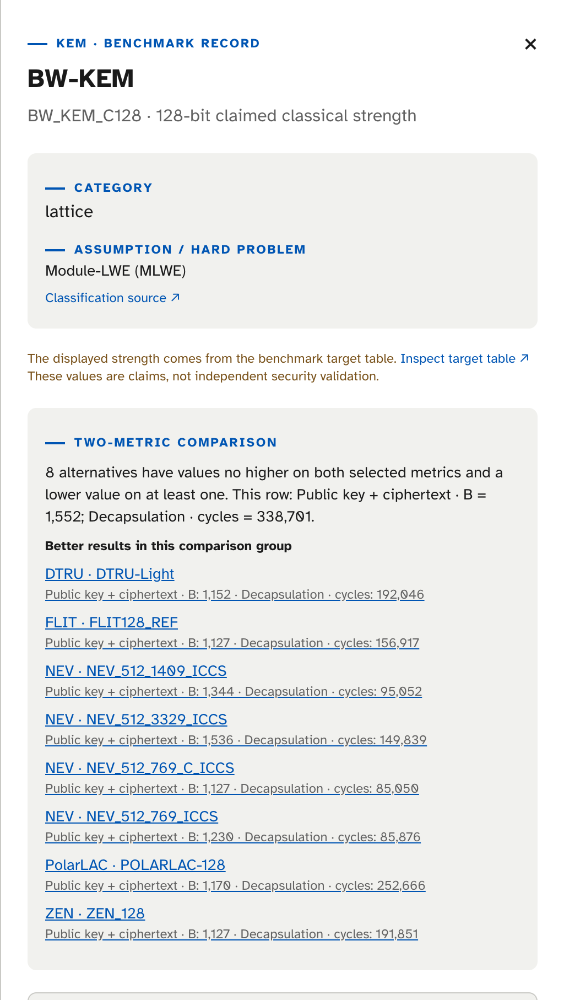
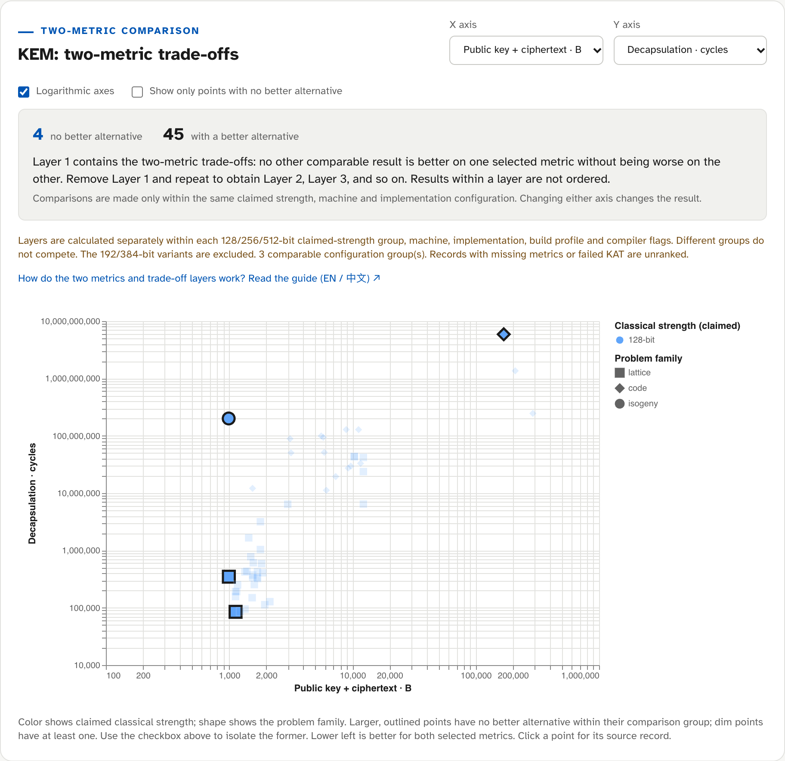

# NGCC Explorer 数据观察：大小与速度如何取舍

*2026 年 10 月 22 日数据快照 · 约 7 分钟阅读*

[NGCC Explorer](../../ngcc-explorer/) 将 NGCC Round 1 的公开参数和性能记录放在同一张可筛选的图表中。本文以 **2026 年 10 月 22 日同步的快照**为准，展示如何从数据中读出通信大小与计算耗时的取舍。网站会检查上游更新；本文的数字则固定在这次快照，不随网站自动改写。想先了解 Layer 1、2、3 的定义，可以阅读[图表入门说明](../ngcc-tradeoff-guide/?lang=zh)。

## 数据覆盖了什么

快照包含 **749 条记录：350 条 KEM、399 条签名**，来自 [ngcc-harness](https://github.com/ngcc-dev/ngcc-harness/tree/8f6bd88576b8725b1cf1a19c360290cdddc0e830) 的独立 Round 1 测试。这里一条记录对应特定参数集、机器、实现与构建配置，**不是一个独立算法**。数据涉及 Intel Core i7-12700 和 Snapdragon X Elite 两台机器；746 条为 reference 实现，3 条为 AVX2 优化实现。Explorer 整理已有记录，并没有重新运行这些测试。

性能值采用上游记录的平均 CPU cycles；公钥、密文与签名大小采用上游公布的外部编码大小。缺失值不补齐。页面标出的 128/256/512-bit 是提交材料或目标表中的**声称经典安全强度**，不是本站独立验证的安全结论。完整的来源和导入规则见项目的 [Data and methods](https://github.com/zhengjieyu/ngcc-benchmark-explorer/blob/main/docs/DATA_AND_METHODS.md)。

## 默认图在比较哪两个成本

KEM 默认横轴是**公钥 + 密文（字节）**，纵轴是**解封装（cycles）**；签名默认横轴是**签名大小（字节）**，纵轴是**验证（cycles）**。两个轴都越小越好。横轴合并了 KEM 的两项传输大小，便于先看总体通信开销；不同协议里公钥可能重复使用，因此也可以改选单独的公钥或密文大小。解封装和验证是默认的接收方操作，密钥生成、封装和签名耗时同样可以切换查看。

## 一个真实的取舍

以下三条记录均属于 **128-bit KEM、Intel Core i7-12700、reference 实现**，且构建配置与编译参数相同（同一参数写了两次，例如重复的 `-std=c99`，只算一次）。表中 cycles 四舍五入到整数；大小是公钥与密文之和。

| 参数集 | 公钥 + 密文 | 解封装 |
| --- | ---: | ---: |
| NEV · NEV_512_769_C_ICCS | 1,127 B | 85,050 cycles |
| BW-KEM · BW_KEM_C128 | 1,552 B | 338,701 cycles |
| DKEM · DKEM-128 | 1,600 B | 254,308 cycles |

BW-KEM 比 DKEM **少 48 B**，DKEM 则比 BW-KEM **少约 84,393 cycles**。只看这两个指标，二者互不支配：选更小的传输量，就不能同时得到这两条记录中更快的解封装。但 NEV 在两项上都低于它们，所以 NEV 是这两条的更优替代。

*在 Explorer 中打开 BW-KEM，会列出同一比较组里优于它的记录，NEV_512_769_C_ICCS 是其中之一，共八条。*这个例子说明，“更优”是明确的**逐项比较**，不是给算法打一个综合分。

## Layer 能告诉我们什么

在选定的两个轴上，如果同组中没有另一条记录两项都不差、且至少一项更小，该记录属于 **Layer 1**。移除这一层后重复计算，得到 Layer 2、Layer 3。两条记录互不支配，并不代表它们在第一层。上例中 NEV 位于 Layer 1，而 NEV 和其他记录都优于 BW-KEM 与 DKEM，所以这两条位于 Layer 6。

*取舍视图，筛选条件为 128-bit、Intel Core i7-12700、Reference。带描边的点在所在组内没有更优替代。左下角的两个方块是 CTL 和 NEV；圆点（QIMEN-PIKE）和菱形（QCTM）各自单独成组，没有可比较的对象。*

Layer 是当前图表与筛选条件下的**局部结果**。Explorer 按声称安全强度、机器、实现、构建配置和编译参数分组，再在各组内比较；不同组的 Layer 1 不能合并成全站冠军。切换 X/Y 轴或筛选条件，Layer 也可能改变。192-bit 和 384-bit 变体目前不参与这一项 Layer 分析；缺少所选指标或未通过相关已知答案测试的记录也不参与。网站的 Layer 1 只表示在这两个成本上暂时没有找到同组更优替代，不能代替安全评估、侧信道评估或应用场景判断。

## 怎么使用这份分析

先在 [NGCC Explorer](../../ngcc-explorer/) 页面筛选你关心的声称强度和机器，再选择与你的协议有关的 X/Y 指标。点开一条记录，核对参数集、实现来源、缺失值和列出的更优替代。若你更在乎密钥存储、发送方耗时或特定平台，就换轴重新看；不要把默认图或 Layer 当成固定排名。数据会继续更新，引用具体数字时请同时注明**快照日期、机器和指标**。
