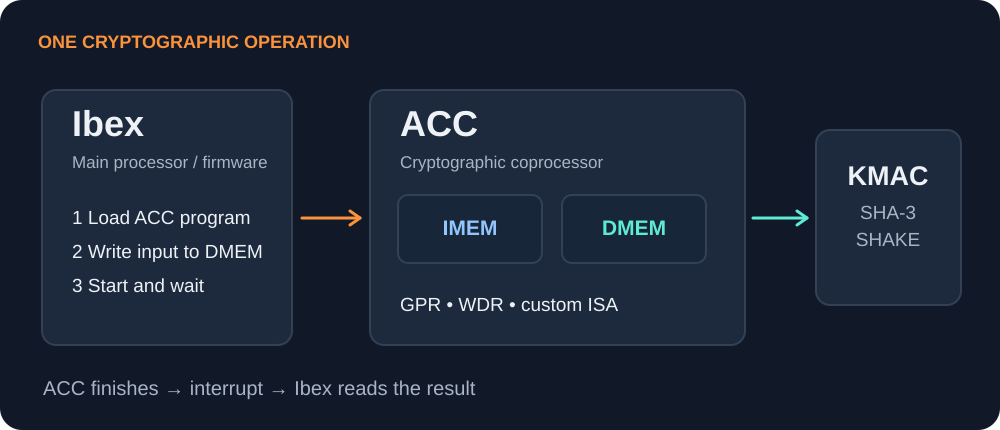
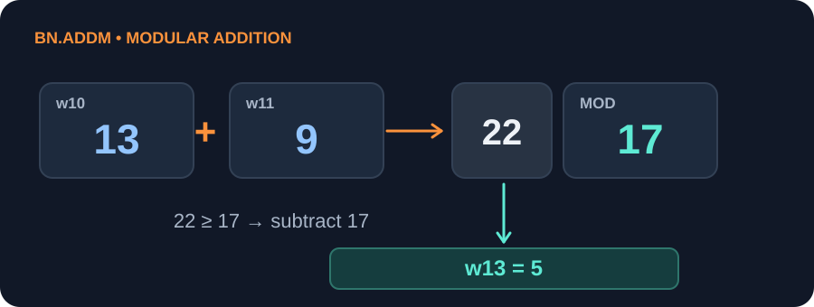
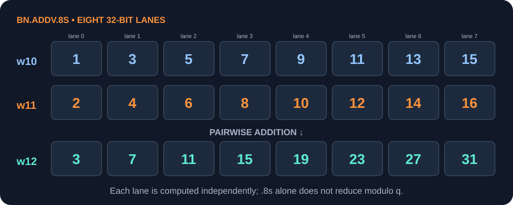
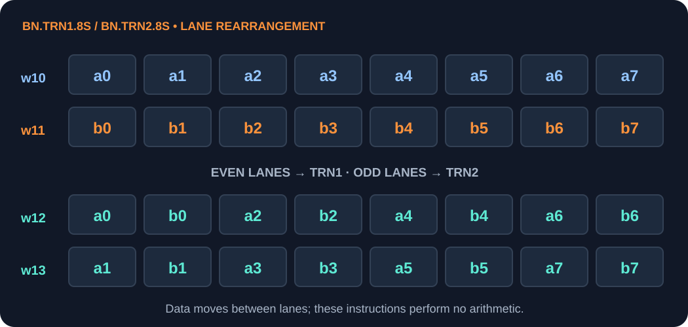

# From Software to Silicon: A Beginner's Guide to Pavona

*For cryptographic engineers and post-quantum cryptography developers · ~30 min read · October 8, 2026*

If you have worked on ML-KEM, ML-DSA, SIMD optimization, or cryptographic software but are new to chip design, Pavona's documentation can feel crowded with unfamiliar names: Ibex, ACC, KMAC, RTL, top-level, and tapeout. What does each do, and how do they fit together? This guide starts with the basic concepts, follows a cryptographic operation through the system, and ends with a small program you can run without hardware.

> **In one sentence:** Pavona provides composable open secure-silicon blocks and reference designs. A main processor runs firmware, a cryptographic coprocessor performs selected operations, and other hardware supports keys, randomness, boot, and isolation.

## 1. First distinguish blocks, designs, and chips

A software project has libraries and applications. A chip project has comparable layers, although combining hardware also requires buses, clocks, resets, memories, and physical implementation.

| Term | A useful first approximation | Pavona examples |
|---|---|---|
| **IP block** | A reusable hardware module | ACC, KMAC, AES, random-number generator, UART |
| **Top-level design** | A system connecting several blocks | Egret, Dragonfly |
| **Chip / silicon** | The manufactured physical device | A design fabricated after tapeout |

An IP (intellectual property) block here is an integrable design asset, not merely an idea. It normally includes RTL, register interfaces, documentation, verification infrastructure, and integration information. RTL is code describing digital hardware behavior: how data moves through registers and combinational logic as the clock advances. The [Pavona documentation](https://docs.pavona.org/) and [repository](https://github.com/pavona/pavona) are good entry points.

**Egret** is a reference design for a discrete hardware Root of Trust (RoT). **Dragonfly** is a RoT intended for integration into a larger SoC. A Root of Trust is the system foundation for capabilities such as secure boot, identity, and key protection. On a first pass, you need not learn every peripheral in either design; the important distinction is how they are integrated. See the [Pavona security overview](https://docs.pavona.org/book/doc/security/index.html).

## 2. Ibex, ACC, and KMAC in one picture

```text
                    Pavona system
  ┌────────────────────────────────────────────┐
  │ Ibex: main processor running firmware      │
  │     │                                      │
  │     ├── calls cryptolib                    │
  │     │        │                             │
  │     │        ├── ACC: crypto programs      │
  │     │        └── KMAC: SHA-3 / SHAKE       │
  │     │                                      │
  │     └── boot, peripherals, system control  │
  └────────────────────────────────────────────┘
```

**Ibex** is the main CPU running embedded firmware. **ACC** (Asymmetric Cryptography Coprocessor) is a separate programmable block for big-number and selected post-quantum operations. **KMAC** is a hardware block providing SHA-3 / SHAKE functions. These are separate hardware components with different jobs, rather than three threads on one CPU. The [ACC introduction](https://docs.pavona.org/book/hw/ip/acc/doc/acc_intro.html) illustrates the interaction between the main processor and ACC.

A coprocessor takes on a specialized task for the main processor. Ibex still organizes the work: it prepares inputs, starts ACC, waits for completion, and handles results. ACC has its own instruction and data memories, registers, and instruction set.

## 3. What happens during one ACC operation?



Before looking at assembly, follow the call sequence:

1. Ibex loads an ACC program into ACC **IMEM** (instruction memory).
2. Ibex places inputs and constants in ACC **DMEM** (data memory).
3. Ibex sets the execute bit; ACC runs its program.
4. ACC reports completion to Ibex.
5. Ibex reads the output from DMEM.

```text
Ibex firmware → load program and inputs → ACC executes → interrupt → Ibex reads result
                           IMEM + DMEM
```

This resembles calling a function, but the boundary is stronger: the processors have different memories, instructions, and access rules. Ibex cannot read ACC memory while ACC is executing, for example, and ACC can lock itself on an error. The [official ACC introduction](https://docs.pavona.org/book/hw/ip/acc/doc/acc_intro.html) explains these isolation properties. They help explain why cryptography is placed in a separate block rather than simply in an ordinary main-CPU function.

## 4. Why does ACC have its own instruction set?

General-purpose processors run many kinds of programs; cryptographic routines repeatedly need a few unusual operations. ACC combines:

- **Control operations:** addresses, loads and stores, loops, and branches using 32-bit general-purpose registers (GPRs).
- **Wide-data operations:** big integers, modular arithmetic, and vector operations using 256-bit wide data registers (WDRs).

The 256-bit width may remind an AVX2 programmer of YMM registers, but the purpose differs. AVX2 is a broad SIMD extension; ACC's wide registers and instructions are designed around cryptography.

For example, `bn.mulqacc` accumulates 64-bit partial products into a dedicated 256-bit accumulator, helping with RSA and elliptic-curve big-number multiplication. `bn.addm` and `bn.subm` target modular addition and subtraction. Here `bn` stands for “big number.” The [ACC ISA guide](https://docs.pavona.org/book/hw/ip/acc/doc/isa.html) gives exact semantics; at this stage, understanding *why* these operations exist matters most.

## 5. Why does PQC need vector instructions too?

RSA and ECC often manipulate large integers. Lattice-based schemes such as ML-KEM and ML-DSA repeatedly process **many small polynomial coefficients**. ML-KEM, for example, involves number-theoretic transforms (NTTs), coefficient multiplication, modular reduction, and data rearrangement. Treating a 256-bit register as one large integer does not express these operations efficiently.

The PQC configuration of ACC therefore adds vector instructions:

| Instruction | Beginner's intuition |
|---|---|
| `bn.addv` / `bn.subv` | Add or subtract multiple coefficients |
| `bn.shv` | Vector shift |
| `bn.trn` | Vector transpose or rearrangement |
| `bn.mulv` / `bn.mulv.l` | Vector multiplication and accumulation |

These descriptions are only a starting intuition. For optimization, consult the [ISA guide](https://docs.pavona.org/book/hw/ip/acc/doc/isa.html) for lane widths, encodings, and exact behavior rather than assuming AVX semantics. The PQC configuration also expands ACC's instruction and data memories and adds a direct connection to KMAC. The [ACC theory of operation](https://docs.pavona.org/book/hw/ip/acc/doc/theory_of_operation.html) explains the configurations.

## 6. What does KMAC do here?

ML-KEM and ML-DSA require more than polynomial arithmetic. Sampling, matrix expansion, and other steps use SHA-3 / SHAKE. ACC handles appropriate arithmetic, while KMAC supplies hashing and extendable-output-function (XOF) hardware.

In the PQC configuration, ACC can exchange data directly with KMAC instead of routing every exchange through Ibex and system memory. A single post-quantum operation may therefore involve cryptolib, ACC, and KMAC. This is a concrete example of hardware/software co-design: the location of an operation affects data movement, performance, and security boundaries. See the [ACC theory of operation](https://docs.pavona.org/book/hw/ip/acc/doc/theory_of_operation.html).

## 7. Cryptolib connects the pieces

Applications generally call the **cryptolib** API rather than manipulating ACC registers. For ML-KEM, think of the layers like this:

```text
Application / firmware
    ↓
cryptolib API: key generation, encapsulation, decapsulation
    ↓
implementation and backend selection
    ├── software backend
    ├── ACC backend
    └── hardened ACC backend
              ↓
        ACC arithmetic + KMAC
```

The [Pavona cryptolib API documentation](https://docs.pavona.org/book/doc/security/cryptolib/cryptolib_api.html) lists ML-KEM-512/768/1024 and these backends. The software backend also uses KMAC for Keccak-related work. Backend selection lets a stable application API work across different hardware capabilities and security requirements. ML-DSA has corresponding parameter sets and implementation paths.

## 8. What does a secure implementation add beyond correct output?

Functional testing first asks whether the result matches the standard or a test vector. Secure silicon must also consider leakage and residual secrets during and after execution:

- **Side channels:** Can timing, power, or electromagnetic behavior reveal a secret?
- **Fault injection:** What happens if an attacker disturbs computation or control flow?
- **State cleanup:** Do registers or memory retain sensitive values after completion or an error?
- **Isolation:** When can the main processor access coprocessor data?

ACC includes features such as no cache or branch prediction, memory scrambling, access to hardware randomness, register cleanup, and error-triggered lock states. The [ACC security-feature overview](https://docs.pavona.org/book/hw/ip/acc/doc/acc_intro.html) explains them. These features do not make every ACC program automatically secure; an algorithm still needs a careful implementation and appropriate evidence.

This is also why cryptolib distinguishes an ordinary ACC backend from a **side-channel-hardened** one. Hardening can involve masking and other protections against physical leakage, beyond secret-independent timing. The [cryptolib documentation](https://docs.pavona.org/book/doc/security/cryptolib/cryptolib_api.html) describes the backend choices.

## 9. Simulation, FPGA, and tapeout

These words refer to different stages of hardware verification and realization:

| Stage | What happens | What it can establish |
|---|---|---|
| **Simulation** | RTL runs in software, for example with Verilator | Functionality and debuggability |
| **FPGA** | The design runs on a reconfigurable board | Integration and firmware behavior |
| **Tapeout** | Completed physical-design data goes to a foundry | Entry into chip fabrication |

Passing simulation does not establish real-chip timing, area, or power. FPGA figures do not directly equal ASIC figures either. When reading a performance claim, first identify its execution environment.

## 10. Where should you start reading code?

Follow one call chain rather than browsing the repository at random:

1. Find a familiar API, such as ML-KEM, in `sw/device/lib/crypto/include/`.
2. Inspect implementation and backend selection in `sw/device/lib/crypto/impl/`.
3. Find the corresponding ACC program in `sw/acc/`; begin with small examples in `code-snippets/`.
4. Read the [ACC introduction](https://docs.pavona.org/book/hw/ip/acc/doc/acc_intro.html) and [ISA guide](https://docs.pavona.org/book/hw/ip/acc/doc/isa.html) alongside the assembly.
5. Then look in `hw/ip/acc/rtl/` to see where the instruction behavior is implemented in hardware.

Ask: Where do inputs come from? Which backend is selected? When does ACC start? Which steps use KMAC? How does the result return? Following that path turns an unfamiliar collection of acronyms into one comprehensible cryptographic software stack.

## 11. Getting started without a board

**Start with a simulator: no FPGA or physical chip is required.** Pavona provides a Python instruction-set simulator (ISS) for ACC programs. When you later want to see firmware and peripherals interact at SoC level, you can use Verilator for RTL simulation. The ISS is faster for learning instructions and debugging a small ACC program; Verilator exercises more of the hardware model. The [ACC development guide](https://docs.pavona.org/book/hw/ip/acc/doc/developing_acc.html) describes both paths.

Follow [Pavona Getting Started](https://docs.pavona.org/book/doc/getting_started/) to install prerequisites and the toolchain, then obtain the [Pavona repository](https://github.com/pavona/pavona). Run the commands below at the **Pavona repository root**, not inside this website repository. Dependencies vary by operating system; check that `hw/ip/acc/util/acc_as.py` can find the RISC-V binutils toolchain.

```bash
# Install prerequisites and the toolchain using the official Getting Started guide
git clone https://github.com/pavona/pavona.git
cd pavona

# Explore the small official examples
ls sw/acc/code-snippets
```

`sw/acc/code-snippets/` includes `pseudo-ops.s`, `mul256.s`, and `modexp.s`. Read `pseudo-ops.s` first if ACC assembly is new to you, then `mul256.s` to study big-number multiplication. The [example-directory documentation](https://docs.pavona.org/book/sw/acc/code-snippets/index.html) describes the other files.

## 12. Your first ACC program: compute 7 + 5

This program uses only base instructions. It adds two 32-bit values in DMEM and writes the answer back. It teaches the entry point, loading, arithmetic, storing, and termination before introducing cryptographic instructions. Save it as `hello_acc.s` at the root of the Pavona repository:

```asm
.section .text.start
  jal x0, main          /* ACC starts here */

.text
main:
  la   x2, input_a      /* x2 = DMEM address of input_a */
  lw   x3, 0(x2)        /* x3 = 7 */
  la   x2, input_b
  lw   x4, 0(x2)        /* x4 = 5 */
  add  x5, x3, x4      /* x5 = 12 */
  la   x2, result
  sw   x5, 0(x2)        /* write 12 to result */
  ecall                 /* finish */

.data
.balign 4
input_a: .word 7
input_b: .word 5
result:  .word 0
```

`la` is a load-address pseudo-instruction. `lw` and `sw` read and write a 32-bit word in DMEM. `.text.start` contains the entry point; `.data` contains initial data. The [ACC software guide](https://docs.pavona.org/book/doc/contributing/sw/acc_sw.html) explains sections, the assembler, and the linker. The [ISA guide](https://docs.pavona.org/book/hw/ip/acc/doc/isa.html) specifies the actual load and store instructions.

With the toolchain installed, assemble, link, and run it in the Python ISS:

```bash
mkdir -p hello_acc_build
hw/ip/acc/util/acc_as.py -o hello_acc_build/hello_acc.o hello_acc.s
hw/ip/acc/util/acc_ld.py -o hello_acc_build/hello_acc.elf hello_acc_build/hello_acc.o
hw/ip/acc/dv/accsim/standalone.py --dump-dmem hello_acc_build/dmem.bin hello_acc_build/hello_acc.elf
xxd -g 4 -l 12 hello_acc_build/dmem.bin
```

The third 32-bit word in the output corresponds to `result` and should contain decimal **12** (`0x0000000c`). If the dump is hard to interpret, use `--verbose` to inspect the instruction trace; check `standalone.py --help` for the options in your checkout. The build workflow follows the [official ACC development guide](https://docs.pavona.org/book/hw/ip/acc/doc/developing_acc.html). The first toolchain installation may take some time.

## 13. From ordinary addition to cryptographic instructions

After understanding the first program, compare it with this **instruction fragment**. It uses wide register `w1` and modulus register `MOD`; it is not standalone, because both `w1` and `MOD` must be initialized first.

```asm
/* Assume w1 contains b and MOD contains m */
loopi 5, 1
  bn.addm w1, w1, w1   /* each iteration: w1 = (2 × w1) mod m */
```

After five iterations, `w1` contains `b × 2^5 mod m`. This [official ACC example](https://docs.pavona.org/book/hw/ip/acc/doc/acc_intro.html) shows a fixed-count hardware loop and modular addition as one specialized operation. The next step is `sw/acc/code-snippets/mul256.s` for wide registers and `bn.mulqacc`. For PQC, compare `bn.addv`, `bn.trn`, and `bn.mulv` against their precise [ISA definitions](https://docs.pavona.org/book/hw/ip/acc/doc/isa.html).

## 14. Dissecting the first program: addresses, registers, and output

The first program only performs one addition, yet it uses three kinds of location that appear in virtually every ACC program: **instructions in IMEM, data in DMEM, and values in registers**. The linker places `.text.start` and `.text` in IMEM and `.data` in DMEM. This is a form of Harvard architecture: instruction and data addresses occupy separate address spaces. Both spaces can start at address zero without conflicting. The [ACC software guide](https://docs.pavona.org/book/doc/contributing/sw/acc_sw.html) describes the linker layout.

Consider these five lines:

```asm
la  x2, input_a    /* x2 holds an address, not the input value */
lw  x3, 0(x2)      /* read a 4-byte word into x3 */
la  x2, input_b
lw  x4, 0(x2)
add x5, x3, x4    /* x5 = x3 + x4 */
```

`x2` through `x5` are 32-bit GPRs. `la` resolves a label to an address; `lw` reads a 32-bit word from that address; `add` computes a result without automatically writing to memory. The later `sw x5, 0(x2)` is therefore essential. Delete `sw` and run the program again: the instruction trace may still show `x5 = 12`, but `result` in DMEM remains its initial zero. This small experiment makes the distinction between a register result and a result visible to the caller concrete.

Try another variation: set `input_a` to `0xffffffff` and `input_b` to `1`. A 32-bit `add` yields `0x00000000`; the carry does not automatically appear in another register. Big-integer arithmetic must handle carries explicitly or use ACC's wide-data instructions. That is one reason a cryptographic coprocessor needs more than ordinary 32-bit addition.

When debugging, check in this order: Did execution reach `ecall`? Are addresses aligned? Are the register values right? Was the output stored to DMEM? `lw` and `sw` require 4-byte alignment; the 256-bit loads and stores below require **32-byte alignment**. Mixing these widths without tracking alignment is a common early mistake. The [ISA guide](https://docs.pavona.org/book/hw/ip/acc/doc/isa.html) documents the error conditions.

## 15. A second complete program: 256-bit modular addition



Now use ACC's wide registers to calculate `(13 + 9) mod 17 = 5`. The numbers are small on purpose, but each lives in a 256-bit data slot so we can learn about WDRs, the modulus register, and wide-data transfers. Save this as `mod_add.s` at the Pavona repository root:

```asm
.section .text.start
  jal x0, main

.text
main:
  li      x3, 10       /* x3 names destination WDR w10 */
  la      x2, a
  bn.lid  x3, 0(x2)   /* DMEM[a] → w10 */

  li      x3, 11
  la      x2, b
  bn.lid  x3, 0(x2)   /* DMEM[b] → w11 */

  li      x3, 12
  la      x2, modulus
  bn.lid  x3, 0(x2)   /* DMEM[modulus] → w12 */
  bn.wsrw 0, w12      /* w12 → MOD special register */

  bn.addm w13, w10, w11  /* w13 = (13 + 9) mod 17 = 5 */

  li      x3, 13
  la      x2, result
  bn.sid  x3, 0(x2)   /* w13 → DMEM[result] */
  ecall

.data
.balign 32
/* Each slot occupies 32 bytes; the first 4 hold the sample value. */
a:       .word 13
         .zero 28
b:       .word 9
         .zero 28
modulus: .word 17
         .zero 28
result:  .zero 32
```

In `bn.lid x3, 0(x2)`, the two GPRs have **different jobs**. `x2` contains the DMEM byte address. The number 10 in `x3` selects wide register `w10`. The instruction says `x3`, rather than naming `w10` directly, because `bn.lid` selects the WDR indirectly. `bn.sid` reverses this transfer: it stores the WDR selected by `x3` at the address in `x2`. The [ISA definitions of `bn.lid` and `bn.sid`](https://docs.pavona.org/book/hw/ip/acc/doc/isa.html) also require 256-bit (32-byte) alignment.

`bn.wsrw 0, w12` writes `w12` to wide special register number 0, **MOD**. Only then does `bn.addm` have the intended modulus. `bn.addm` has an important precondition: both operands should be smaller than MOD. Here, 13 and 9 are both below 17; their sum is 22, so subtracting 17 once yields 5. It is not a universal remainder operation that repeatedly reduces arbitrary large inputs. If you change the inputs to 30 and 9 without reducing them first, you should not expect the mathematical remainder 5. The [`bn.addm` definition](https://docs.pavona.org/book/hw/ip/acc/doc/isa.html) states its input-range condition.

Build and run it like the first program:

```bash
hw/ip/acc/util/acc_as.py -o hello_acc_build/mod_add.o mod_add.s
hw/ip/acc/util/acc_ld.py -o hello_acc_build/mod_add.elf hello_acc_build/mod_add.o
hw/ip/acc/dv/accsim/standalone.py --dump-dmem hello_acc_build/mod_add.bin hello_acc_build/mod_add.elf
xxd -g 4 -s 96 -l 32 hello_acc_build/mod_add.bin
```

The four 32-byte slots are contiguous, so `result` begins at byte offset 96. The first 32-bit word should appear as `05000000` in a byte dump: that is little-endian storage of the value 5, **not** the integer `0x05000000`. Add `--verbose` to the simulator to inspect each instruction. To inspect the linked program, run `hw/ip/acc/util/acc_objdump.py -d hello_acc_build/mod_add.elf`.

## 16. From one 256-bit integer to a vector of PQC coefficients

The previous program treated `w10` as one 256-bit integer. The same bits can instead represent **eight 32-bit coefficients** or **sixteen 16-bit coefficients**. Vector instructions start from this change of interpretation: the register width stays the same, but its contents are divided into lanes.

```text
The same 256-bit WDR

Scalar view: [              one 256-bit integer              ]
.8s view:   [32][32][32][32][32][32][32][32]
.16h view:  [16][16][16][16] ... 16 elements total
```

If `w10` and `w11` each hold eight 32-bit coefficients, this **instruction fragment** adds matching lanes:

```asm
bn.addv.8s w12, w10, w11   /* eight pairs of 32-bit lanes */
```

If the first two pairs are `(1, 2)` and `(3, 4)`, their corresponding results are `3` and `7`. `.8s` means eight 32-bit elements; `.16h` means sixteen 16-bit elements. The plain `.8s` form adds lane values and truncates to 32 bits; it **does not automatically reduce modulo ML-KEM's modulus**. The ISA also defines `m` variants that enable modular reduction, which require a correctly initialized MOD and the specified input range. The [`bn.addv` semantics](https://docs.pavona.org/book/hw/ip/acc/doc/isa.html) give the details.

The hard part of vector code is often not just how many coefficients one instruction processes, but **which coefficient occupies each lane**. An NTT butterfly needs particular coefficients to meet at each stage. Arithmetic instructions add, subtract, or multiply them, while instructions such as `bn.trn` rearrange them. A fast addition instruction cannot help if its operands are in the wrong lanes. When reading ML-KEM assembly, label the coefficient index in each lane on paper and trace one load, one rearrangement, and one addition before trying to understand the entire NTT.

## 17. Four common questions while learning ACC code



**Why is the simulator output wrong?** First verify `.data` alignment and the output offset, then check that execution reached `sw` or `bn.sid`. For modular arithmetic, confirm that MOD was initialized and inputs meet the instruction's range condition. Computing the right value in a register without writing it back to DMEM is a frequent cause.

**Why does `bn.lid` use a GPR to select a WDR?** That is its instruction format. After `li x3, 10`, `bn.lid x3, 0(x2)` targets `w10`; change `x3` to 11 and it targets `w11`. The ISA also provides auto-increment forms for addresses or WDR indices, but a first program benefits from explicit steps. See the [ISA guide](https://docs.pavona.org/book/hw/ip/acc/doc/isa.html).

**How do the Python ISS and Verilator differ?** The ISS models ACC instruction semantics and is convenient for quick runs and instruction traces. Verilator simulates RTL, which can exercise the hardware implementation and broader interactions, at a higher runtime cost. First make a tiny program work in the ISS, then follow the [ACC development guide](https://docs.pavona.org/book/hw/ip/acc/doc/developing_acc.html) to move to RTL simulation.

**Why not write ordinary C?** ACC is meant for cryptographic offload and currently has no ordinary C compiler. Ibex firmware and cryptolib primarily use C; ACC programs are primarily assembly. They collaborate through DMEM and control interfaces, but they are distinct programs on distinct processors. The [ACC software guide](https://docs.pavona.org/book/doc/contributing/sw/acc_sw.html) explains the present toolchain.

## 18. A concrete example of vector rearrangement

We have called `bn.trn` a “data rearrangement” instruction, but that phrase is abstract. Consider two vectors with eight 32-bit lanes each, numbered from least to most significant:

```text
w10 = [a0, a1, a2, a3, a4, a5, a6, a7]
w11 = [b0, b1, b2, b3, b4, b5, b6, b7]
```

`bn.trn1.8s` takes **even-indexed** lanes from both sources and interleaves them. `bn.trn2.8s` does the same with **odd-indexed** lanes:

```asm
bn.trn1.8s w12, w10, w11
bn.trn2.8s w13, w10, w11
```

```text
w12 = [a0, b0, a2, b2, a4, b4, a6, b6]
w13 = [a1, b1, a3, b3, a5, b5, a7, b7]
```

These are **instruction fragments**, not standalone programs. First load the inputs into `w10` and `w11`, and use an ACC configuration with the PQC extension. Neither instruction adds or multiplies anything; each only changes lane order. Placing one before `bn.addv` changes which coefficients meet in an addition. Similar rearrangements arise between NTT stages as butterfly pairings change. The [`bn.trn` ISA entry](https://docs.pavona.org/book/hw/ip/acc/doc/isa.html) also covers variants with 16-, 64-, and 128-bit elements.

A vector add does not complete an NTT by itself. A real kernel must load twiddle factors, reduce multiplication results, plan the coefficient layout between stages, use DMEM efficiently, and work within the register budget. The small example provides the first question to ask while reading the assembly: **after this instruction, which coefficient is in each lane?**

## 19. How does an ACC program join a real application?



The first two programs were loaded directly from ELF files by the ISS, so we did not write Ibex-side code. In a real system, the main processor has to put the ACC program and data in the right memories, set the execute bit, wait for completion, check status, and read the result. The following is **conceptual pseudocode**; these are not actual Pavona API names to compile:

```c
// Conceptual only: use cryptolib and the ACC driver in a real project.
acc_load_program(program_image);  // write ACC IMEM
acc_write_data(input, input_size); // write ACC DMEM
acc_start();                       // set execute bit
acc_wait_done();                   // wait for interrupt or poll status
if (acc_has_error()) {
    handle_error();
} else {
    acc_read_data(output, output_size);
}
```

Why not read back immediately after `acc_start()`? Ibex access to ACC memories is restricted during execution. The ACC program must reach `ecall` to enter the completion sequence. The caller must check for errors or a locked state rather than assume that elapsed time implies a valid result. The [ACC programmer's guide](https://docs.pavona.org/book/hw/ip/acc/doc/programmers_guide.html) describes polling, interrupts, the data window, and `ecall`.

An application using ML-KEM usually never sees these load-and-wait steps. It calls the cryptolib key-generation, encapsulation, or decapsulation API. Cryptolib then selects a software or ACC backend according to the build configuration. ACC arithmetic and KMAC SHAKE operations do their respective work. When comparing a tiny ISS program with a complete cryptolib algorithm, keep three layers distinct: **the API is the caller's contract; the backend selects an implementation; the hardware driver hands a concrete program to ACC.** This also explains why performance analysis must account for loading, data movement, and KMAC interaction, rather than counting only ACC core instructions.

A practical way to continue reading source is to track one input and one output through each layer: where key-generation randomness originates, how the backend receives it, which ACC program consumes it, where the output lands in DMEM, and how it becomes the key returned by the API. Following one complete path first makes it easier to compare backends and hardening later.

## 20. Recap and glossary

```text
Pavona: composable open secure-silicon project
Ibex: main processor running firmware
ACC: programmable cryptographic coprocessor
KMAC: hardware providing SHA-3 / SHAKE functions
cryptolib: software cryptographic API and implementations
IMEM / DMEM: ACC instruction / data memories
GPR / WDR: ACC general-purpose / 256-bit wide registers
RTL: code describing digital-hardware behavior
Top-level: a system design connecting IP blocks
Tapeout: submitting physical-design data for fabrication
```

The key path through Pavona is: **an application calls cryptolib; Ibex firmware organizes the work; ACC and KMAC perform selected cryptographic operations; RTL defines the hardware behavior; and a top-level design integrates the blocks into a system.**

### Further reading

- [Pavona documentation](https://docs.pavona.org/) and [GitHub repository](https://github.com/pavona/pavona)
- [Introduction to ACC](https://docs.pavona.org/book/hw/ip/acc/doc/acc_intro.html)
- [ACC ISA guide](https://docs.pavona.org/book/hw/ip/acc/doc/isa.html)
- [ACC theory of operation](https://docs.pavona.org/book/hw/ip/acc/doc/theory_of_operation.html)
- [ACC development guide](https://docs.pavona.org/book/hw/ip/acc/doc/developing_acc.html)
- [Cryptolib API](https://docs.pavona.org/book/doc/security/cryptolib/cryptolib_api.html)
